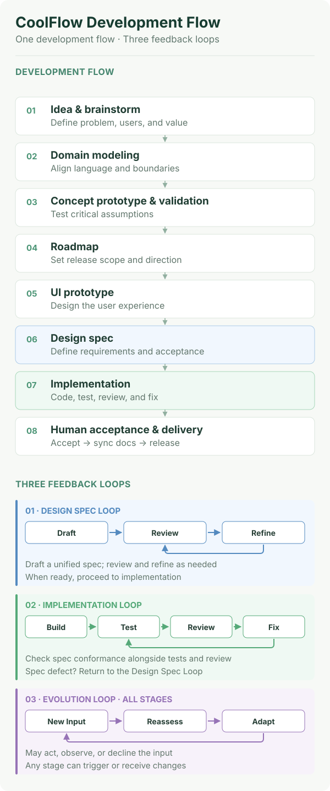

# CoolFlow

**English** | [简体中文](README.zh-CN.md)

**AI can write code. Building software takes more than code.**

CoolFlow is a lightweight development roadmap for independent developers building with AI—from a rough idea to a working, verifiable product.

## Why CoolFlow?

AI makes writing code easier, but building a product still raises familiar questions:

- What should you build first?
- Is the AI changing code without a clear product direction?
- Does a feature actually work, or does it only look finished?

## What CoolFlow provides

- **One Development Flow:** From idea discovery, prototypes and roadmap to implementation, human acceptance and release.
- **Three Adaptive Loops:** Improve designs through review, validate implementations through testing and code review, and adapt product direction as new information emerges.
- **Lightweight documentation:** Keep goals, requirements, key decisions and reusable engineering knowledge.

<p align="center">
  
</p>

Skip, combine or revisit stages as needed. The flow is a guide, not a rigid checklist.

## Get started

Use CoolFlow with your preferred coding Agent; no specific Agent vendor or installation tool is required.

**New project — install CoolFlow Init**

Open your coding Agent and send:

```text
Please install this Skill globally using the standard installation method for your current Agent:
https://github.com/CooLingLab/CoolFlow/tree/main/skills/coolflow-init
```

After installation, open a **new, empty project directory** and ask:

> Use `coolflow-init` to initialize this empty project.

The Skill checks the target directory before writing and refuses any other files or folders, including hidden entries. It creates the CoolFlow project documentation, verifies the result, and stops without starting Brainstorm or writing application code.

If your Agent cannot install Skills, see the manual installation and optional installer methods in the [Getting Started guide](GETTING_STARTED.md).

**Existing project — inspect before adopting**

Do not use `coolflow-init` for an existing or non-empty project. Follow the inspect-first [Existing Project Adoption guide](GETTING_STARTED.md#b-existing-project--inspect-before-adopting): review the current project, propose a selective adoption plan, and wait for approval before changing files.

[Complete Getting Started guide](GETTING_STARTED.md) · A work directory may be opened during discovery; the formal Spec is written when the chosen work enters Design Spec Loop.

## CoolFlow Skills

CoolFlow includes three optional Agent Skills:

| Skill | Purpose | Why it matters | Use when |
| --- | --- | --- | --- |
| [`coolflow-init`](skills/coolflow-init/SKILL.md) | Create the CoolFlow documentation skeleton | Gives every new project the same CoolFlow starting point, not a one-off setup | Starting a new, empty project |
| [`coolflow-advisor`](skills/coolflow-advisor/SKILL.md) | Recommend methods, Skills and tools for a specific task | Keeps method and tool choices small, relevant and grounded in the current task | Choosing an approach for a development task |
| [`coolflow-skill-creator`](skills/coolflow-skill-creator/SKILL.md) | Create, adapt, test and maintain native CoolFlow Skills | Turns external ideas and repeated practice into a maintained personal Skill library—an asset that improves through real use and validation | Building or reviewing a Skill |

`coolflow-init` is the project setup entry point. The other two are optional on-demand Skills. Install a Skill with your Agent's standard installation method; `coolflow-init` has an example above.

**What mature CoolFlow looks like:** Every project starts from the same clear, flexible flow; each iteration leaves durable documentation and evidence; and your Skill library becomes a personal arsenal of adapted, validated capabilities that make the next project faster and more reliable.

## Four Golden Rules

CoolFlow also offers four memorable principles for the **human developer**, inspired in part by the Airbus Golden Rules for Pilots. You can use them even without adopting the whole flow:

1. **Keep It Working → Ship Small → Improve** — protect what already works, deliver small increments, then improve.
2. **Know the Actual State** — distinguish planned, changed, tested, accepted and released.
3. **Keep a Way Back** — keep practical version checkpoints and recovery options.
4. **Prove It Works** — trust direct, reproducible evidence, not just an AI agent's claim.

These are decision principles, **not mandatory commands for AI agents**. Put concrete agent instructions in the target project's `AGENTS.md`.

[Read the Golden Rules](methodology/golden-rules.md)

## Why a pilot?

CoolFlow was started by Cooling, a pilot exploring AI-assisted software development. Aviation SOPs, situational awareness and cross-checks inspired its emphasis on priorities, actual state, recoverability and verification.

## More documentation

- [Getting Started](GETTING_STARTED.md) — new and existing projects.
- [Development Flow](methodology/flow.md) · [Adaptive Loops](methodology/loops.md) — the method.
- [Documentation Standard](standards/documentation.md) · [Templates](templates/) — documentation conventions and reusable templates.

## Ecosystem & Tool Selection

CoolFlow defines a development methodology and documentation standard; it does not bundle or require a particular Agent toolchain. These references help you compare external approaches and choose the smallest useful complement:

- [Framework Comparison](flowecosystem/framework-comparison.md) — compare documented capabilities, workflow coverage, project state and knowledge capture across major AI development frameworks.
- [Solution Catalog](flowecosystem/catalog.md) — broad ecosystem research by development stage.
