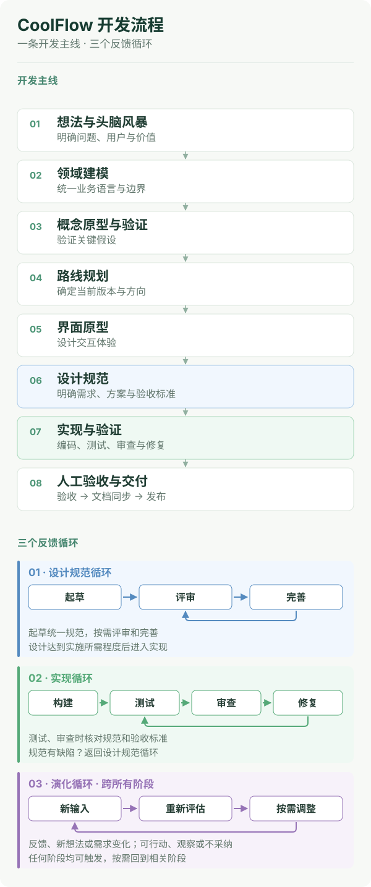

# CoolFlow

[English](README.md) | **简体中文**

**AI 会写代码，但开发不只有写代码。**

CoolFlow 是面向 AI 独立开发者的轻量工程方法，帮助你从想法走向可验证、可交付的产品。

## 为什么需要 CoolFlow？

AI 让写代码变容易了，但没有替我们建立做项目的框架。真正卡住人的，往往不是代码，而是：

- 一个项目该先做什么、后做什么？
- 产品、领域、架构和功能之间怎么衔接？
- 做到什么程度算完成，什么该评审、什么算验收？
- 这次做完，能留下什么？

CoolFlow 不提供现成的经验答案，而是把这些问题放进一条流程和一套文档里：让你在还没有经验时也有框架可依，并把做过的事变成自己的经验。

## CoolFlow 提供什么？

- **一个开发流程（Development Flow）：** 从想法探索、原型、Roadmap 到实现、验收和发布，明确每个阶段要回答的问题和应留下的产出。
- **三个反馈循环（Adaptive Loops）：** 通过设计评审完善方案，通过测试与代码审查验证实现，并根据新信息持续调整产品方向。
- **轻量文档规范：** 为目标、领域、架构、关键决策和可复用经验提供固定的落点。

<p align="center">
  
</p>

流程可以按需跳过、合并或回到之前的阶段，不必机械执行。

## 快速开始

使用你现有的 Coding Agent。CoolFlow 不绑定特定 Agent 厂商或安装工具。

**新项目——安装 CoolFlow Init**

打开你平时使用的 Coding Agent，把下面这句话和 Skill 地址发给它：

```text
请帮我安装这个 Skill，并按照当前 Agent 支持的标准方式安装到全局：
https://github.com/CooLingLab/CoolFlow/tree/main/skills/coolflow-init
```

安装完成后，打开一个全新的空项目目录，告诉 Agent：

> 使用 `coolflow-init` 初始化这个空项目。

Skill 会先检查目标目录；如果存在其他文件或文件夹（包括隐藏文件），就会拒绝执行。通过检查后，它会创建 CoolFlow 项目文档结构、验证结果，然后停止，不会自动开始 Brainstorm 或编写应用代码。

如果你的 Agent 不支持 Skill 安装，请查看 [Getting Started](GETTING_STARTED.zh-CN.md) 中的手动安装和备用方式。

**已有项目——先检查现状再采用**

不要在已有项目或非空目录中使用 `coolflow-init`。请按照[已有项目采用指南](GETTING_STARTED.zh-CN.md)，先检查现状、提出选择性采用方案，并在获得确认后再修改文件。

[完整使用指南](GETTING_STARTED.zh-CN.md) · 探索阶段可建立工作目录；确定开发目标、进入 Design Spec Loop 时再编写正式 Spec。

## CoolFlow Skills

CoolFlow 提供四个可选的 Agent Skills：

| Skill | 用途 | 为什么需要 | 使用时机 |
| --- | --- | --- | --- |
| [`coolflow-init`](skills/coolflow-init/SKILL.md) | 创建 CoolFlow 项目文档骨架 | 让每个新项目都从同一套 CoolFlow 框架开始，而不只是一次性的初始化 | 新建空项目 |
| [`coolflow-advisor`](skills/coolflow-advisor/SKILL.md) | 针对具体任务推荐方法、Skills 和工具 | 针对当前任务给出少量、相关、可执行的选择，减少盲目试错 | 选择开发方法或工具 |
| [`coolflow-docs-review`](skills/coolflow-docs-review/SKILL.md) | 按项目本地文档规范检查文档 | 在不强制套用 CoolFlow 默认规范的前提下，发现文档结构漂移和失效引用 | 审查或修正文档合规性 |
| [`coolflow-skill-creator`](skills/coolflow-skill-creator/SKILL.md) | 创建、改造、测试和维护 CoolFlow 原生 Skill | 把外部方法与重复实践沉淀成自己的 Skill 资产，并经过真实使用和反复验证，越用越成熟 | 开发或审查 Skill |

`coolflow-init` 是项目初始化入口，其余三个是按需使用的可选 Skill。安装方式遵循当前 Agent 的标准流程；`coolflow-init` 的示例见上文。

**CoolFlow 的成熟形态：** 每个项目都沿着同一套清晰而灵活的流程推进，每次迭代都留下可复用的文档和验证证据；你的 Skill 库则沉淀为一份真正的数字资产——一套经过自己改造、经过真实任务反复验证的个人武器库，让下一个项目更快、更稳。

## 四条 Golden Rules

CoolFlow 还整理了四条面向**人类开发者**的判断原则，部分灵感来自空客飞行员金科玉律。即使不使用完整的开发流程，你也可以独立借鉴：

1. **Keep It Working → Ship Small → Improve** — 先保护已有正确行为，小步交付，再持续改进。
2. **Know the Actual State** — 分清计划、实际修改、已验证、人工验收和已发布。
3. **Keep a Way Back** — 保留可靠的版本检查点和真正可行的恢复方案。
4. **Prove It Works** — 用可复查的实际证据确认结果，而不是只听 AI 说“已经完成”。

它们是对人的提醒，**不是强制要求 AI 执行的四条命令**。具体的 Agent 规则应由目标项目的 `AGENTS.md` 承担。

[阅读 Golden Rules 中文版](methodology/golden-rules.zh-CN.md)

## 项目缘起

CoolFlow 由飞行员 Cooling 发起。航空 SOP、态势感知和交叉检查启发我把明确优先级、掌握状态、保留退路与验证结果的思想带入 AI 辅助软件开发。

## 文档导览

CoolFlow 的每份文档都相对简短，可以独立阅读。按当前需要，从下表直接进入：

| 文档 | 内容 |
| --- | --- |
| [Getting Started](GETTING_STARTED.zh-CN.md) | 新项目初始化、在已有项目中采用 CoolFlow，以及从想法探索到发布的第一个增量。 |
| [开发流程](methodology/flow.zh-CN.md) | 八个阶段、每个阶段要回答的问题，以及应留下的产出。 |
| [反馈循环](methodology/loops.zh-CN.md) | 设计、实现和演进三个反馈循环，以及各自适用的时机。 |
| [阶段活动](methodology/activities.zh-CN.md) | 每个阶段内的具体活动，以及活动之间的边界。 |
| [Golden Rules](methodology/golden-rules.zh-CN.md) | 四条面向人的判断原则，不采用完整流程也能使用。 |
| [文档规范](standards/documentation.zh-CN.md) | 每类项目文档放在哪里、何时创建、如何演进。 |
| [初始化契约](standards/initialization.zh-CN.md) | `coolflow-init` 具体会检查什么、创建什么、不会改动什么。 |
| [评审实践](standards/reviews.zh-CN.md) | 设计评审和代码评审各自检查什么，又不替代什么。 |
| [模板](templates/) | 项目文档骨架、工作文档模板，以及可选的 ADR / Solutions 示例。 |

**仓库维护：** [AGENTS.md](AGENTS.md) 说明如何开发本仓库；[内部场景评审](flowreviews/scenarios/README.md) 记录 CoolFlow 如何验证自身的规范、模板和 Skills。它们不是应用测试，也不会被复制到目标项目。

## 生态与工具选型

CoolFlow 定义开发方法和文档规范，不绑定特定 Agent 工具链。[生态目录](flowecosystem/README.md)可以帮助你了解现有方案，并选择最小、合适的补充工具：

- [开发框架能力对比](flowecosystem/framework-comparison.md) — 比较主流 AI 开发框架的能力覆盖、工作流、项目状态管理与经验沉淀。
- [外部方案目录](flowecosystem/catalog.md) — 广义开发框架、Skills、方法与工具研究。
- [工程实践](flowecosystem/engineering-practices.md) — AI 辅助开发中可选的并行协作、评审、发布验证、权限与决策记录等实践。
